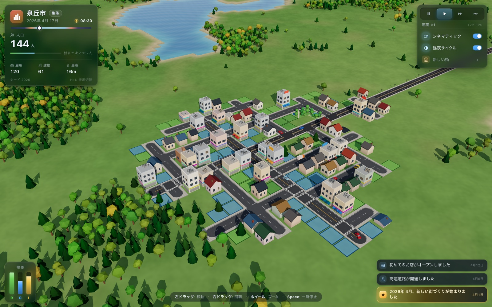
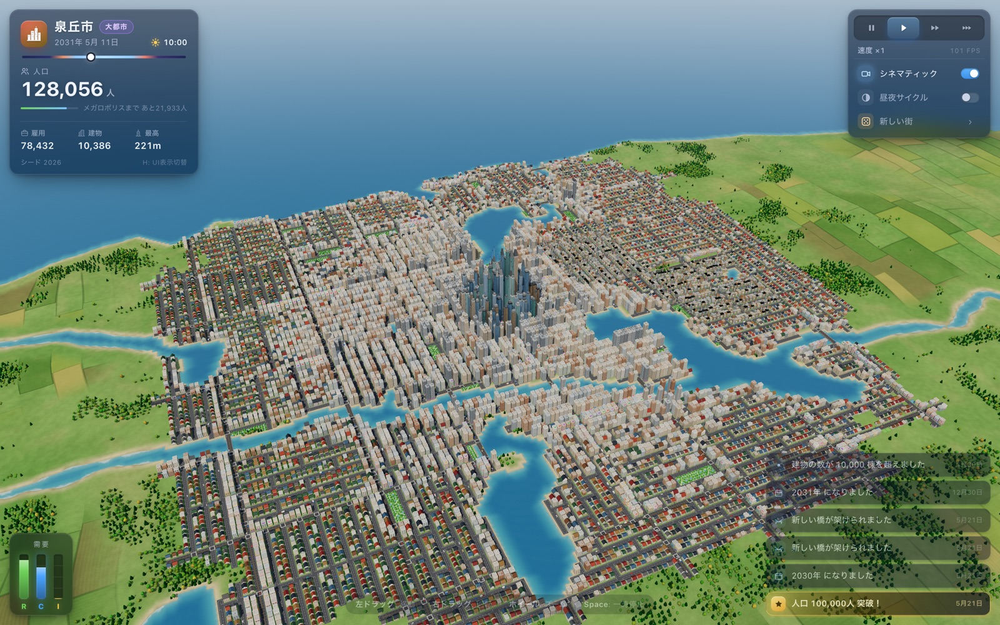
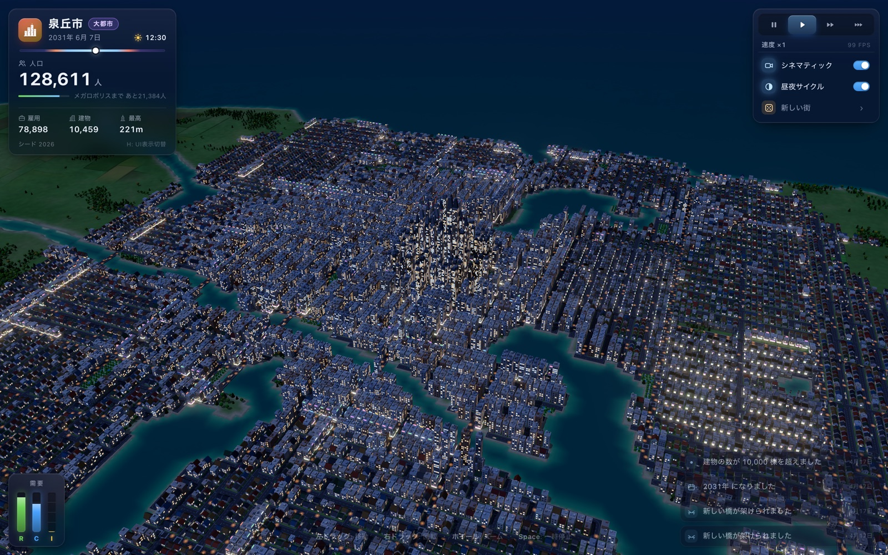

# CityGrow — 自動で育つ街

俯瞰カメラで眺めているだけで、街がひとりでに育っていく Three.js 製のブラウザデモです。
小さな集落から始まり、道路が伸び、区画が生まれ、やがて高層ビルの建ち並ぶ大都市になります。

**▶ デモ: https://tanuu5.github.io/citygrow/**



| 昼（人口約13万人） | 夜 |
|---|---|
|  |  |

## 特徴

- **自動成長シミュレーション** — 高速道路の開通から始まり、大通り・生活道路・橋が伸びて街区を形成。住宅（緑）・商業（青）・工業（黄）・公園の区画が需要に応じて埋まり、建物はレベルアップしながら高くなります
- **スカイライン** — 都心ほど高く、郊外ほど低い高さの勾配。人口に応じて初の高層ビル、超高層ビルが誕生します
- **昼夜サイクル** — 夕焼け、月明かり、ビルの窓明かり、街灯、車のヘッドライト（ブルーム付き）
- **交通** — 道路網を走る車（左側通行）
- **HUD** — 人口・雇用・日付・RCI 需要バー・ニュースフィード・ランク（集落 → 村 → 町 → 市 → 大都市 → メガロポリス）
- **シード** — `?seed=12345` のように URL に付けると同じ街を再現できます

## 操作

| 操作 | 内容 |
|---|---|
| 左ドラッグ | 移動 |
| 右ドラッグ | 回転 |
| ホイール | ズーム |
| `Space` | 一時停止 / 再開 |
| `1` `2` `3` | 速度（×1 / ×3 / ×8） |
| `C` | シネマティックカメラ（自動で街を周回） |
| `N` | 昼夜サイクルの ON / OFF |
| `H` | HUD の表示切替 |

## ローカルで動かす

ビルド不要の静的サイトです。任意の静的サーバーで配信してください（ES Modules のため `file://` 直開きでは動きません）。

```bash
python3 -m http.server 8123
# → http://localhost:8123
```

Three.js（r170）は CDN から読み込むため、インターネット接続が必要です。

## テスト

シミュレーション層は Three.js / DOM に依存しない純粋な JS で、Node.js（20 以上）で検証できます。

```bash
node tests/sim.test.mjs
```

複数シードで成長ペース・不変条件（道路と建物の整合、道路網の連結性など）・決定性をチェックします。

## 構成

```
index.html            エントリ（importmap で three を解決）
style.css             HUD のスタイル
src/
  main.js             配線とメインループ
  config.js           定数・座標ヘルパー
  core/               イベント、シード付き乱数・ノイズ
  sim/                地形生成・都市成長シミュレーション（純粋 JS）
  render/             ステージ（カメラ・光・空・影）、地形・水・木、道路、交通、建物
  ui/hud.js           HUD
tests/sim.test.mjs    シミュレーションのテスト
SPEC.md               設計仕様（モジュール間の契約）
```

## 補足

Cities: Skylines などの街づくりゲームに着想を得た非公式の個人制作物で、それらの権利者とは関係ありません。

## ライセンス

[MIT](LICENSE)
